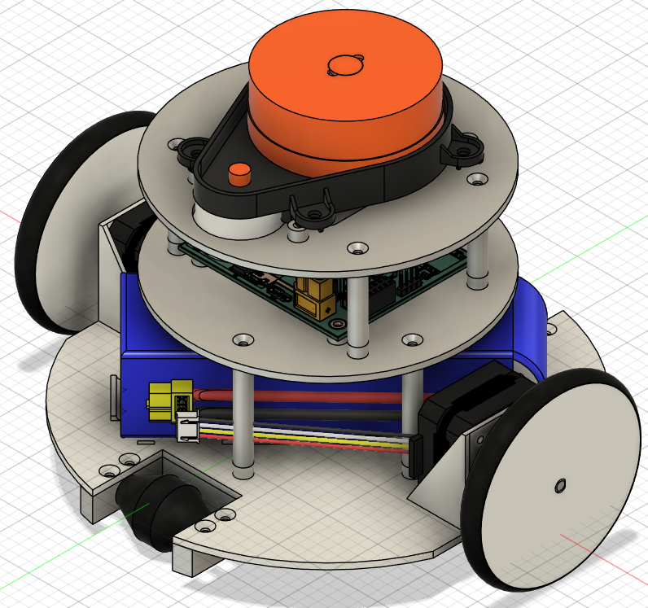

# Minibot

[](LICENSE)
[](https://platformio.org/)
[](https://docs.ros.org/en/jazzy/)
[](https://micro.ros.org/)
[](datasheets/)

An open, low-cost **differential-drive autonomous robot** built around the **ESP32** and **micro-ROS**, designed as a teaching platform for **ROS 2**. The firmware streams LiDAR scans and wheel odometry to a ROS 2 host over WiFi and drives the robot from `cmd_vel` commands, so students can experiment with the full perception → localization → navigation stack on real hardware.



## Features

- **micro-ROS over WiFi** — the ESP32 talks to a ROS 2 host through a micro-ROS Agent.
- **Differential drive** with two NEMA-17 stepper motors (STEP/DIR drivers) and step-based odometry.
- **2D LiDAR** — a Xiaomi/Delta-2G class LiDAR parsed on-device and published as `sensor_msgs/LaserScan`.
- **TF + odometry** published natively from the microcontroller (`odom` → `base_link`).
- **FreeRTOS multitasking** — separate tasks for LiDAR reading, scan publishing, and the micro-ROS executor, pinned across both ESP32 cores.
- **3D-printable chassis** — Fusion 360 source, STEP, and ready-to-print STL files included.

## Repository layout

| Path                                          | Description                                                                                           |
| --------------------------------------------- | ----------------------------------------------------------------------------------------------------- |
| [source/minibot/](source/minibot)             | **Full firmware** — motors **and** LiDAR with micro-ROS (class-based, the one to flash on the robot). |
| [source/minibot_lidar/](source/minibot_lidar) | LiDAR-only firmware, publishes `sensor_msgs/LaserScan`. Useful for bring-up and debugging.            |
| [source/minibot_nema/](source/minibot_nema)   | Motors-only firmware: odometry, TF, and `cmd_vel` subscription. Useful for bring-up and debugging.    |
| [designs/](designs)                           | Mechanical design: Fusion 360 (`.f3z`), STEP, and printable STLs.                                     |
| [datasheets/](datasheets)                     | Component datasheets (ESP32 DevKit C V4, NEMA-17, TMC2202).                                           |
| [docs/](docs)                                 | Images and documentation assets.                                                                      |
| [schematics/](schematics)                     | Wiring/schematic assets.                                                                              |

The two single-purpose firmwares (`minibot_lidar`, `minibot_nema`) are kept as standalone bring-up projects so each subsystem can be validated in isolation before flashing the combined `minibot` firmware.

## Hardware

- **MCU board:** ESP32 — AZ-Delivery DevKit C V4 (`az-delivery-devkit-v4`)
- **Motors:** 2× NEMA-17 stepper motors
- **Motor drivers:** TMC2202 (STEP/DIR), hardware microstepping = 2
- **LiDAR:** Xiaomi / Delta-2G compatible (frame protocol `0xAA` header, frame type `0x61`), UART @ 115200
- **Power & chassis:** 3D-printed body (see [designs/](designs))

Datasheets for the main components are in [datasheets/](datasheets).

### Default pinout

**Full firmware — [source/minibot/](source/minibot)**

| Signal                  | ESP32 GPIO | Defined in                                              |
| ----------------------- | ---------- | ------------------------------------------------------- |
| Left motor STEP / DIR   | 19 / 21    | [nema_motors.cpp](source/minibot/src/nema_motors.cpp)   |
| Right motor STEP / DIR  | 32 / 33    | [nema_motors.cpp](source/minibot/src/nema_motors.cpp)   |
| Motor enable            | 23         | [nema_motors.cpp](source/minibot/src/nema_motors.cpp)   |
| LiDAR UART RX (Serial2) | 26         | [xiaomi_lidar.cpp](source/minibot/src/xiaomi_lidar.cpp) |
| LiDAR motor enable      | 25         | [xiaomi_lidar.cpp](source/minibot/src/xiaomi_lidar.cpp) |

> Note: the standalone `minibot_nema` and `minibot_lidar` firmwares use **different** pin assignments (e.g. motors on GPIO 26/25/27/14, LiDAR RX on GPIO 17). Always check the `#define`s at the top of the corresponding source file.

### Robot constants (full firmware)

- Wheel radius: `0.043 m`
- Wheel base (track width): `0.21 m`
- Steps per revolution: `200 × microstep`
- Max wheel speed: `600 steps/s`

## Requirements

- [PlatformIO](https://platformio.org/) (CLI or the VS Code extension)
- A ROS 2 installation on the host (firmware targets **Humble**)
- A running **micro-ROS Agent** on the host
- Python 3 with `pyserial`, `numpy`, `matplotlib` — only for the LiDAR serial plotting script

## Configuration

Before building, edit the WiFi credentials and the micro-ROS Agent endpoint near the top of the `main.cpp` you intend to flash:

```cpp
IPAddress agent_ip(192, 168, 0, 186);   // your host running the micro-ROS Agent
size_t    agent_port = 8888;

char ssid[] = "your-wifi-ssid";
char psk[]  = "your-wifi-password";
```

- Full firmware: [source/minibot/src/main.cpp](source/minibot/src/main.cpp)
- LiDAR only: [source/minibot_lidar/src/main.cpp](source/minibot_lidar/src/main.cpp)
- Motors only: [source/minibot_nema/src/main.cpp](source/minibot_nema/src/main.cpp)

Also review the hardware pins (see [pinout](#default-pinout) above) and, if needed, the robot dimensions used for odometry.

The full firmware ships a [custom.meta](source/minibot/custom.meta) that raises the micro-XRCE-DDS transport MTU and entity limits — keep it in sync if you add publishers/subscriptions.

## Build, flash and monitor

Each folder under [source/](source) is an independent PlatformIO project. From the project directory:

```bash
cd source/minibot          # or source/minibot_lidar, source/minibot_nema

pio run                     # compile
pio run -t upload           # flash over USB
pio device monitor -b 115200   # open the serial monitor
```

## Running with ROS 2

1. Start the micro-ROS Agent on your ROS 2 host (matching the IP/port configured in firmware):

   ```bash
   ros2 run micro_ros_agent micro_ros_agent udp4 --port 8888
   ```

2. Power on the ESP32. It connects to WiFi, registers its nodes with the Agent, and synchronizes its clock with the host.
3. Inspect the graph:

   ```bash
   ros2 topic list
   ros2 topic echo /scan
   ```

### Topics and frames

**Full firmware — [source/minibot/](source/minibot)** (nodes `minibot_lidar` + `minibot_nema`)

| Direction | Topic           | Type                    |
| --------- | --------------- | ----------------------- |
| Publish   | `/scan`         | `sensor_msgs/LaserScan` |
| Publish   | `/minibot/odom` | `nav_msgs/Odometry`     |
| Publish   | `/tf`           | `tf2_msgs/TFMessage`    |
| Subscribe | `/cmd_vel`      | `geometry_msgs/Twist`   |

Frames: `odom` → `base_link`, plus `base_laser_link` for the scan.

**LiDAR only — [source/minibot_lidar/](source/minibot_lidar)**

| Direction | Topic   | Type                    |
| --------- | ------- | ----------------------- |
| Publish   | `/scan` | `sensor_msgs/LaserScan` |

**Motors only — [source/minibot_nema/](source/minibot_nema)**

| Direction | Topic              | Type                  |
| --------- | ------------------ | --------------------- |
| Publish   | `/minibot/odom`    | `nav_msgs/Odometry`   |
| Publish   | `/tf`              | `tf2_msgs/TFMessage`  |
| Subscribe | `/minibot/cmd_vel` | `geometry_msgs/Twist` |

> The `cmd_vel` topic name differs between firmwares (`/cmd_vel` in the full build, `/minibot/cmd_vel` in the motors-only build). Remap accordingly when teleoperating.

Drive the robot with, for example:

```bash
ros2 run teleop_twist_keyboard teleop_twist_keyboard
```

## LiDAR serial visualization (optional)

[source/minibot_lidar/plot_lidar_serial.py](source/minibot_lidar/plot_lidar_serial.py) plots raw LiDAR returns in 2D directly from the serial port — handy for verifying the sensor without ROS 2.

```bash
pip install pyserial numpy matplotlib
python source/minibot_lidar/plot_lidar_serial.py
```

Adjust `SERIAL_PORT` (default `/dev/ttyUSB0`) at the top of the script to match your device.

## Mechanical design

3D models live in [designs/](designs):

- `Fusion/Robotito v2.f3z` — editable Fusion 360 source
- `STEP/Robotito v2.step` — neutral CAD exchange format
- `STLs/` — printable parts (main body, front wheels and tires, caster wheel + support, LiDAR support, PCB support and spacers)

## Implementation notes

- The full firmware runs three FreeRTOS tasks: LiDAR serial parsing, `LaserScan` assembly/publishing, and the micro-ROS executor — pinned across both cores.
- Motor stepping is driven from a hardware timer ISR; `cmd_vel` only updates the target wheel speeds.
- Odometry is integrated from stepper step counts and published together with the `odom` → `base_link` TF.
- A periodic sync timer aligns the ESP32 clock with the micro-ROS Agent so message timestamps are valid on the host.
- If the Agent becomes unreachable, the full firmware tears down and recreates its ROS entities to recover the session automatically.

## License

This project — firmware, mechanical designs, schematics, and documentation — is licensed under the **Creative Commons Attribution-NonCommercial-ShareAlike 4.0 International License (CC BY-NC-SA 4.0)**.

You are free to **share** and **adapt** the material for **non-commercial** purposes, provided you give appropriate **credit** and license your derivatives under the **same** terms. Commercial use requires prior written permission from the author.

See [LICENSE](LICENSE) for the full text · [License summary](https://creativecommons.org/licenses/by-nc-sa/4.0/)
